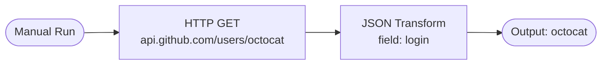
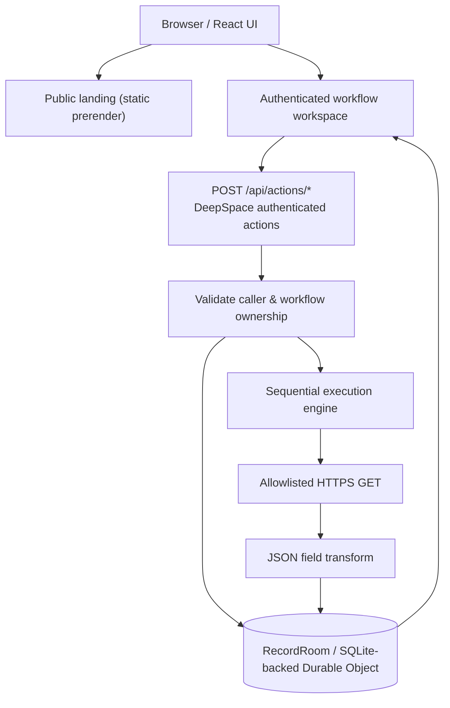

<div align="center">

# ⚡ FlowPilot

### Visual workflow automation, without the black box.

**Build API workflows on a drag-and-drop canvas. Execute them securely. Inspect every step.**

[Explore features](#features) · [Quick start](#quick-start) · [Architecture](#architecture) · [Security](#security-and-execution-limits)

</div>

---

## Overview

**FlowPilot** is a full-stack workflow automation studio built with **React, TypeScript, DeepSpace, and Cloudflare Workers**. It lets authenticated users create and organize workflows, arrange nodes on a visual canvas, run sequential API/JSON-processing steps, and investigate results through a persistent execution history.

FlowPilot is intentionally a **focused automation engine**, not a general-purpose web scraper or a complete n8n alternative. Its current scope emphasizes an understandable developer experience, traceable execution, and carefully constrained server-side actions.

### What you can do

- **Design visually** — create workflows and drag nodes around a pan-and-zoom canvas; node positions are saved.
- **Run API pipelines** — fetch JSON from approved HTTPS endpoints, then extract a JSON property.
- **Inspect executions** — view run status, per-step duration, error messages, and bounded input/output previews.
- **Review past runs** — select saved execution history and highlight the corresponding nodes.
- **Start from templates** — create a two-step demo using a built-in GitHub API or JSONPlaceholder example.
- **Manage workflows** — create, update, search, pause, and delete workflows in an authenticated workspace.

> **Execution model:** Workflows currently execute **manually and sequentially**. Visual node placement does not change execution order. The connections illustrate the saved step sequence; custom branching, editable edges, scheduling, and webhook triggers are **not implemented**.

## Features

| Area | Implemented behavior |
| --- | --- |
| **Visual editor** | Draggable nodes, panning, zoom controls, connected canvas, persistent node coordinates |
| **Workflow management** | Create/list/update/delete workflows; draft, active, and paused states |
| **Step types** | `http_get` (allowlisted HTTPS JSON endpoint) and `json_transform` (one JSON property) |
| **Execution engine** | Ordered step execution, result propagation, error handling, time limits |
| **Execution debugger** | Success/failure node indicators; step input/output previews, duration, error inspection |
| **History** | Saved run results, selectable earlier executions, refreshable run list |
| **Starter templates** | GitHub profile lookup, GitHub follower count, Todo title extractor |
| **Authentication** | DeepSpace-authenticated requests and owner-scoped server actions |
| **Public website** | Responsive, SEO-ready, statically prerendered landing page |
| **Tests** | Vitest unit tests, TypeScript checking, ESLint, DeepSpace test commands |

## Try a workflow

The built-in **GitHub profile lookup** template demonstrates the full execution path:



**Step 1 — HTTP GET**

```http
GET https://api.github.com/users/octocat
Accept: application/vnd.github+json
```

**Step 2 — JSON Transform**

```json
{ "field": "login" }
```

**Expected final output**

```json
"octocat"
```

To reproduce this in the UI:

1. Sign in and open **Workflows**.
2. Select **GitHub profile lookup** under **Quick-start templates**.
3. Open the generated workflow and select **Run workflow**.
4. Review **Execution history**. Select a node's **Inspect** action to see its execution details.

The request uses the **public GitHub REST API** and requires network access. GitHub may return a rate-limit or access error; FlowPilot records the failure rather than fabricating an output.

## Tech stack

| Layer | Technology |
| --- | --- |
| Frontend | React 19, TypeScript, Vite 8, React Router |
| UI | Tailwind CSS 4, HeroUI 3, Lucide icons, Cairo font |
| Platform / backend | DeepSpace SDK, Cloudflare Workers |
| Persistence | DeepSpace RecordRoom collections backed by SQLite-based Durable Objects |
| Authentication | DeepSpace authentication and server-side authorization |
| Testing | Vitest, Playwright/DeepSpace testing commands, ESLint, TypeScript |

## Architecture



### Data model

| Collection | Purpose |
| --- | --- |
| `workflows` | Workflow metadata, owner, status, and saved node layout |
| `workflow_steps` | Owner-scoped steps, execution position, type, and JSON configuration |
| `workflow_runs` | Run status, time, duration, errors, per-step previews, and final output |

The workflow editor and execution actions live behind authenticated DeepSpace actions. Privileged actions independently check ownership rather than trusting user-supplied `ownerId` values.

### Important code locations

```text
src/
  actions/
    workflows.ts              # Workflow CRUD, steps, template creation
    execution.ts              # Authenticated run and history actions
    execution-engine.ts       # Ordered HTTP/JSON execution
    dev-fetch-fallback.ts     # Local-only recovery for specific workerd errors
  components/
    WorkflowCanvas.tsx        # Drag-and-drop canvas and run-status highlighting
    WorkflowRunsPanel.tsx     # Saved executions
    NodeExecutionInspector.tsx# Per-node debugging details
  lib/
    workflow-api.ts           # Authenticated client action calls
    workflow-layout.ts        # Saved canvas layout validation
    workflow-templates.ts     # Built-in examples
    workflow-run-preview.ts   # Run-history decoding
  pages/
    index.tsx                 # Static marketing landing page
    (app)/(protected)/
      workflows.tsx           # Workflow library and editor
  schemas/
    flowpilot-schema.ts       # RecordRoom collections and permissions
worker.ts                     # Cloudflare / DeepSpace worker entry
vite.config.ts                # Vite, prerendering, local development config
```

## Quick start

### Requirements

- **Node.js:** `>=22.15 <23`, `>=24 <25`, or `>=26 <27` (Node.js 24 recommended).
- **npm:** `>=11.6.0`.
- A **DeepSpace account** with access to the application environment.
- Internet access for the supported public API demonstrations.

Check your installed versions:

```bash
node --version
npm --version
```

### Install and run

```bash
git clone https://github.com/Shehab1001/flowpilot.git
cd flowpilot
git switch dev

npm ci
npx deepspace auth login
npm run dev
```

Open **http://localhost:5173/** for the landing page, then enter **Workflow Studio**.

> The `dev` branch contains the features documented here. If your checkout is on another branch, switch to `dev` before installing or running the project.

### Optional: Docker on Windows

If you prefer a consistent Node.js environment, from **Windows CMD** in your existing project directory (`D:\flowpilot`):

```cmd
docker run -dit --name flowpilot-dev -p 5173:5173 -v "D:\flowpilot:/workspace" -w /workspace node:24-bookworm sleep infinity
docker exec -it flowpilot-dev bash
```

Then **inside the container**:

```bash
npm ci
npx deepspace auth login
npm run dev
```

For later sessions, reuse the existing container instead of creating another:

```cmd
docker start flowpilot-dev
docker exec -it flowpilot-dev bash
```

If `flowpilot-dev` already exists, **do not run `docker run` again**. This setup keeps source code on the Windows drive but does not automatically persist DeepSpace login state outside the container. Local port `5173` must be available.

## Development and testing

Run these from the repository root:

| Command | Purpose |
| --- | --- |
| `npm run dev` | Start the DeepSpace local development server |
| `npm run lint` | Run ESLint |
| `npm run type-check` | Run the TypeScript compiler without emitting files |
| `npm run test:unit` | Run Vitest unit tests |
| `npm run build` | Build the Vite production bundle |
| `npm run test` | Run the DeepSpace test suite |
| `npm run test:smoke` | Run the DeepSpace smoke tests |
| `npm run test:api` | Run the DeepSpace API tests |
| `npm run test:e2e` | Run the DeepSpace end-to-end tests |
| `npm run deploy` | Deploy using the authenticated DeepSpace CLI |

**Pre-deployment checks**

```bash
npm run lint
npm run type-check
npm run test:unit
npm run build
npm run test
```

These are **commands to run**, not a claim that the current branch has passed all checks or that production has been verified.

## Security and execution limits

FlowPilot is designed as a deliberately restricted automation demo. Its implementation includes:

- **Owner authorization:** workflow, step, run-history, and saved-layout actions verify the authenticated user's ownership.
- **Restricted destinations:** HTTP nodes accept HTTPS requests to **`api.github.com`** or **`jsonplaceholder.typicode.com`** only. Arbitrary URLs, embedded credentials, non-HTTPS schemes, and explicit ports are rejected.
- **No redirect following:** HTTP redirects are not followed, preventing a redirect from bypassing the destination allowlist.
- **Bounded execution:** up to **20 steps per workflow**, **8 seconds per HTTP request**, **25 seconds per execution**, and **128 KB per HTTP response**.
- **Safe transforms:** JSON transforms read a single property name; they do not evaluate arbitrary JavaScript.
- **Bounded persistence:** individual step input/output previews are truncated before saving; the history query returns up to **50 runs**.
- **Local development fallback:** a fixed-target Vite proxy may be used for specific opaque workerd networking errors **in development only**. Production does not use that local recovery path.

These controls reduce risk but **do not constitute a comprehensive SSRF security review** or a guarantee that every external request will succeed. This application should not be treated as a general-purpose unrestricted HTTP client.

## Current scope and roadmap

**Currently supported:** manual sequential workflows using HTTP GET and JSON field extraction, saved canvas positions, history, debugger, templates, and authenticated workflow management.

**Not yet supported:**

- Scheduled executions or event/webhook triggers
- Conditional branches, loops, or user-defined graph routing
- Connecting arbitrary nodes by dragging edges
- General-purpose web scraping or HTML parsing
- Arbitrary endpoints, secrets/credential integrations, or HTTP POST nodes
- Streaming live per-node animations while an execution is running

Potential next steps include **production verification**, expanded integration tests, safer credential handling, more node types, and editable execution graphs. These are **future improvements**, not implemented features.

## Deployment

FlowPilot is configured for the **DeepSpace / Cloudflare Workers** deployment pipeline.

After signing in and passing the checks above:

```bash
npm run deploy
```

Deploying requires an appropriately configured DeepSpace application and account permissions. **No public production URL is claimed in this README**; add the verified deployment link after publishing and testing the live app.

## Project and references

- **Source repository:** https://github.com/Shehab1001/flowpilot
- **Development branch:** https://github.com/Shehab1001/flowpilot/tree/dev
- **DeepSpace documentation:** https://docs.deep.space/
- **Cloudflare Workers:** https://developers.cloudflare.com/workers/
- **React:** https://react.dev/
- **Vite:** https://vite.dev/
- **GitHub REST API:** https://docs.github.com/en/rest

---

<div align="center">
  <strong>FlowPilot</strong> — design visually, execute intentionally, debug confidently.
</div>
